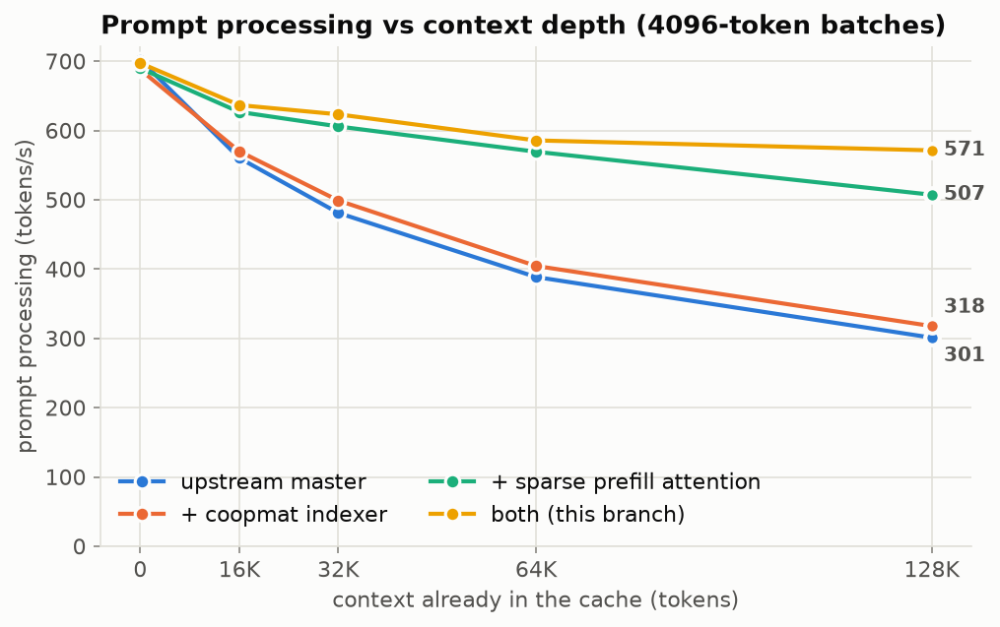

# Dr. Sparselove: Qwen3.8-Flash-Next at 256K context on AMD Strix Halo

**Paper:** [Dr. Sparselove, or: How I Learned to Stop Worrying and Love the 256K Context](strix-halo/REPORT.md). It has the profiles, kernel timings, ablations and the things that didn't work.

This is a fork of [llama.cpp](https://github.com/ggml-org/llama.cpp). This branch makes long-context prompt processing of Qwen3.8-Flash-Next much faster on the Vulkan backend. It also contains the setup I use to run the model on a Ryzen AI Max+ 395 box with 128 GB, with the measurements behind every setting.

The model uses sparse attention: each query attends to at most 2,051 positions chosen by a small indexer. While processing a prompt, upstream Vulkan ran this as dense attention over the entire cache with a mask on top. The deeper the context, the worse it got. This branch sends prompt batches through the sparse path that the backend already had for decoding, and gives the indexer a cooperative-matrix kernel.

| | upstream | this branch |
|---|---:|---:|
| prompt processing, empty cache | 702 tok/s | 697 tok/s (no change) |
| prompt processing, 32K already in cache | 481 tok/s | 623 tok/s |
| prompt processing, 128K already in cache | 301 tok/s | 571 tok/s |
| one 250K-token prompt, end to end | 11.2 min | 7.9 min |
| next turn at 250K: 2K new tokens | 8.2 s | 5.0 s |
| decode, no drafting | 26.6 tok/s | 26.3 tok/s |
| decode, MTP drafting (effort xhigh) | 34.7 tok/s | 34.5 tok/s |

Outputs are the same: all 5,693 flash-attention and 210 indexer backend tests pass, and perplexity matches within noise. Decode speed doesn't change. On upstream I also measured 43 tok/s at `low` reasoning effort, and about 100 tok/s when the model rewrites a file it was given (MTP + n-gram drafting).



The full story is in the paper, [strix-halo/REPORT.md](strix-halo/REPORT.md).

## The changes

The code changes are two commits on top of upstream master `8d60873df`.

`vulkan: use sparse flash attention for prompt batches` touches `ggml-vulkan.cpp`. The sparse attention path (compact each row's selected positions, then gather only those K/V rows) was only reachable for batches of up to 8 rows. Now prompt batches with a sparse-mask hint use it too, once the cache is at least 4x the selection (16x for quantized K/V). The kernel is 2x faster at 16K, 3.4x at 32K and 9.2x at 128K.

`vulkan: cooperative matrix lightning indexer` adds `lightning_indexer_cm1.comp`, which computes 64x64 key/token tiles with 16x16x16 f16 MMAs. It's 4.2-4.9x faster than the scalar shader, which is still used for 16 tokens or fewer.

Both can be switched off at runtime: `GGML_VK_FA_SPARSE_PREFILL_DISABLE=1` and `GGML_VK_DISABLE_LIGHTNING_INDEXER_COOPMAT=1`. `GGML_VK_FA_SPARSE_PREFILL_RATIO=<n>` changes the threshold.

## Running it

First, let the GPU use most of the memory. amdgpu allows 62 GB by default, which is less than the weights. Add these to the kernel command line and reboot:

```
amdgpu.gttsize=126976 ttm.pages_limit=32505856
```

On Limine (Omarchy, for example), append them to `KERNEL_CMDLINE[default]` in `/etc/default/limine` and run `limine-update`. `cat /sys/class/drm/card*/device/mem_info_gtt_total` should then print about 133 GB. Many Strix Halo guides also add `amd_iommu=off`; it helps a little, but it switches off IOMMU DMA protection.

Build (needs the Vulkan headers and `glslc`):

```bash
cmake -S . -B build-vulkan -DGGML_VULKAN=ON -DCMAKE_BUILD_TYPE=Release
cmake --build build-vulkan -j --target llama-server llama-bench
```

Download the model, about 98 GB. On my connection `aria2c` was a lot faster than the Hugging Face client:

```bash
M=~/models/qwen3.8-flash-next; mkdir -p $M/UD-IQ4_XS
for i in 1 2 3 4; do echo "https://huggingface.co/unsloth/Qwen3.8-Flash-Next-GGUF/resolve/main/UD-IQ4_XS/Qwen3.8-Flash-Next-UD-IQ4_XS-0000$i-of-00004.gguf"; echo "  dir=$M/UD-IQ4_XS"; done > dl.txt
echo "https://huggingface.co/ggml-org/Qwen3.8-Flash-Next-GGUF/resolve/main/mtp-Qwen3.8-Flash-Next-Q8_0.gguf" >> dl.txt; echo "  dir=$M" >> dl.txt
aria2c -i dl.txt -j 2 -x 16 -s 16 -k 16M -c
```

Then start the server with [`strix-halo/launch/qwen38.sh`](strix-halo/launch/qwen38.sh). It serves the web UI and the OpenAI-compatible API on http://127.0.0.1:8081:

```bash
MODEL_DIR=~/models/qwen3.8-flash-next strix-halo/launch/qwen38.sh
```

The defaults in that script, and why:

| setting | reason |
|---|---|
| `-c 262144` | the full native context. 36 of the 48 layers are linear attention, so an f16 cache for all 256K is only about 7 GB |
| `-lm mmap` | keeps the 28.8 GB n-gram table in the page cache. Other load modes copy it into process memory |
| `-b 4096 -ub 4096` | 30% faster prompts than the default 512 |
| `--spec-type draft-mtp,ngram-mod --spec-draft-n-max 2 --spec-draft-sampling probabilistic` | MTP with 2-token drafts is the fastest general setting. The n-gram drafter costs about 5% on text that doesn't repeat and more than doubles the speed when the model rewrites code it has seen; `NGRAM=0` turns it off |
| T 1.0, top-p 0.95, top-k 20 | Qwen's recommended sampling for thinking mode |

`EFFORT=low|medium|xhigh` changes the default reasoning effort, `THINK=0` turns thinking off and `DRAFT=0` turns drafting off.

## Reproducing the numbers

All the numbers come from the scripts in [`strix-halo/scripts/`](strix-halo/scripts/), and the raw output is in [`strix-halo/results/`](strix-halo/results/). `python3 strix-halo/scripts/plots.py` redraws the figures (it needs matplotlib).

```bash
BASE_BIN=/path/to/upstream/build-vulkan/bin MODEL_DIR=~/models/qwen3.8-flash-next strix-halo/scripts/ablation.sh
cmake -S . -B build-vulkan -DLLAMA_BUILD_TESTS=ON && cmake --build build-vulkan -j --target test-backend-ops
python3 strix-halo/scripts/kernels.py ./build-vulkan/bin/test-backend-ops kernels.json
```

If you run them on a Strix Halo machine, keep it idle. The CPU and GPU share one power budget, and anything busy on the CPU lowers the GPU clock. `ablation.sh` waits for a quiet machine and logs the clock for that reason.

## About this fork

Apart from the two Vulkan commits and the `strix-halo/` folder, everything here is upstream llama.cpp at `8d60873df`. For everything else, see the [llama.cpp README](https://github.com/ggml-org/llama.cpp#readme) and [`docs/`](docs/). The license is upstream's MIT license ([LICENSE](LICENSE)).
