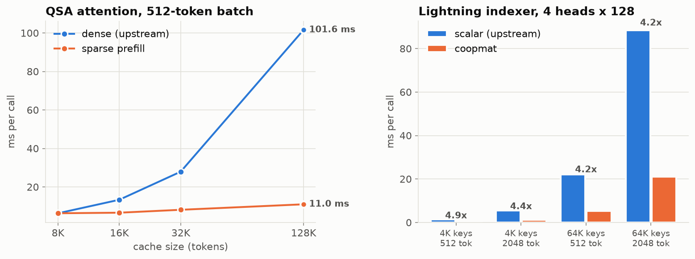
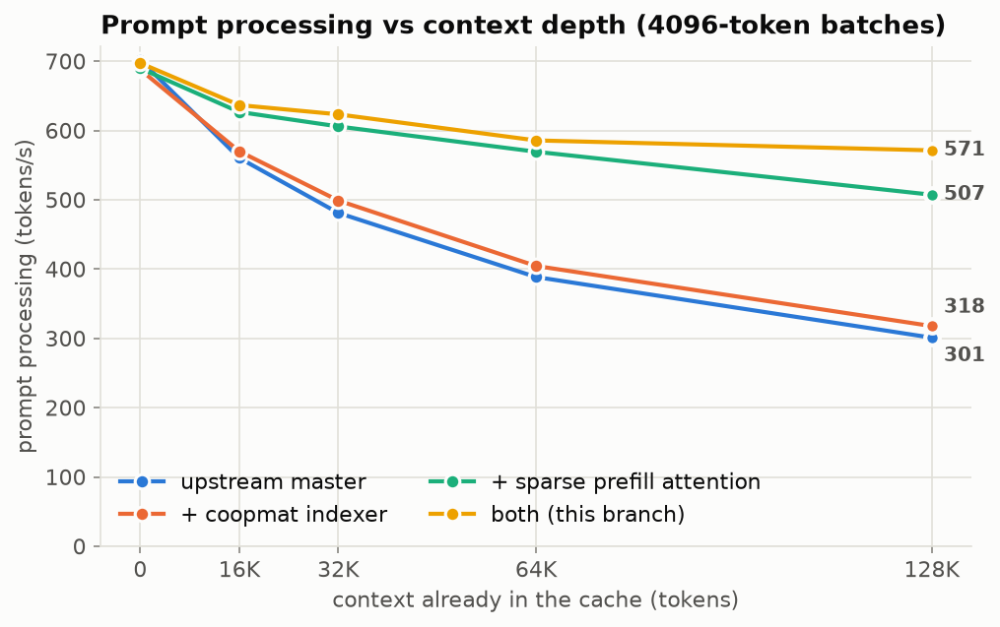
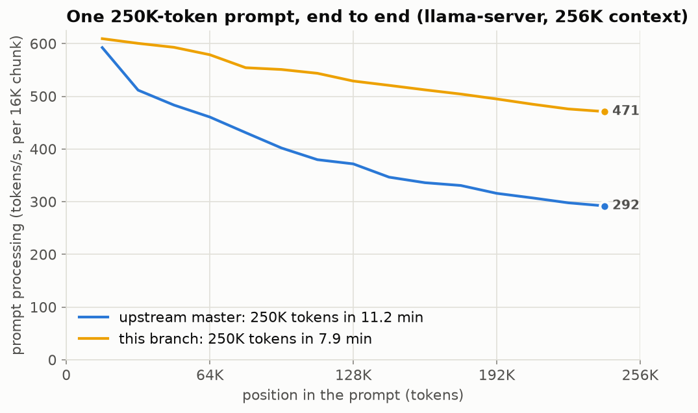
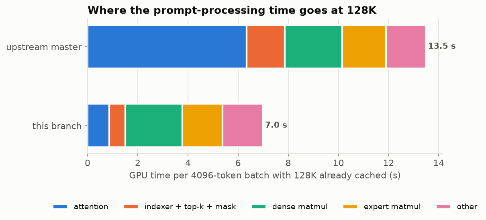
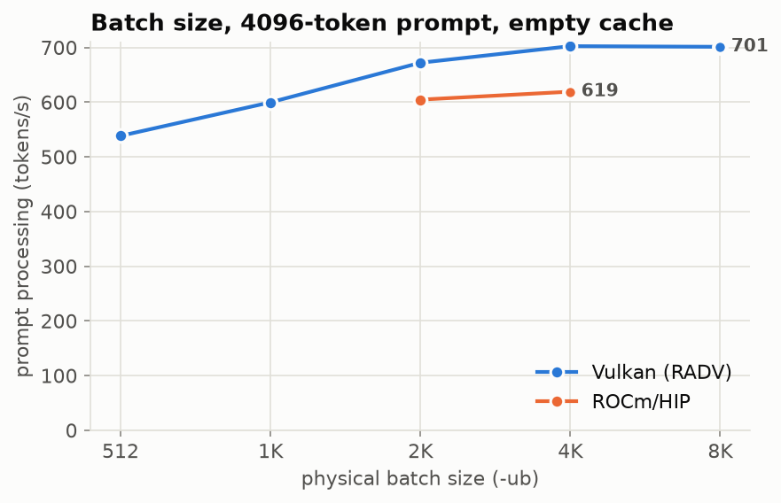
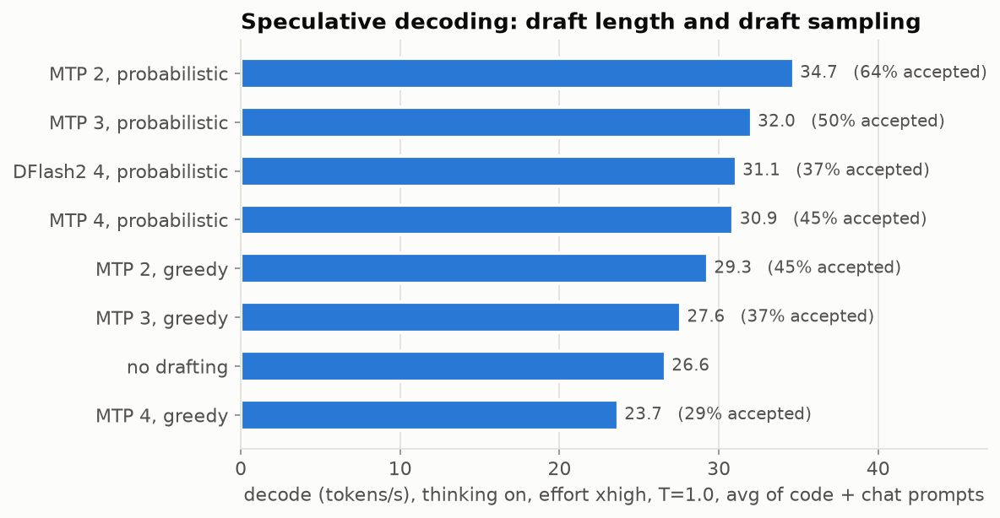
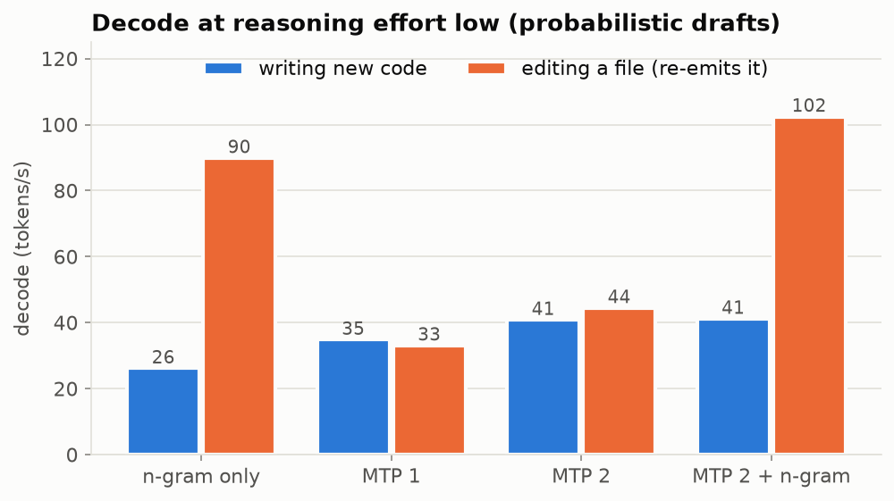

# Dr. Sparselove, or: How I Learned to Stop Worrying and Love the 256K Context

### Making Qwen3.8-Flash-Next's sparse attention actually sparse on AMD Strix Halo (Vulkan)

*unixsysdev, November 2026. Code: this branch. Raw data in [`results/`](results/), figures in [`figures/`](figures/) (made by [`scripts/plots.py`](scripts/plots.py)).*

## Abstract

Qwen3.8-Flash-Next is a 125B mixture-of-experts model with about 6B active parameters per token, a 51B n-gram embedding table, hybrid Gated-DeltaNet / sparse-attention layers and a 256K native context. It fits on a 128 GB AMD Ryzen AI Max+ 395 ("Strix Halo") in a 4-bit quant. Prompt processing with llama.cpp's Vulkan backend, however, falls off a cliff as the context grows: about 700 tokens/s with an empty cache, under 300 tokens/s at 250K. The reason turned out to be simple. The model's sparse attention lets each query look at no more than 2,051 positions, but during prompt processing the Vulkan backend ran it as ordinary dense attention over the whole cache, with a mask. The indexer that picks those 2,051 positions ran on a scalar kernel. I changed two things: prompt batches now use the sparse attention path the backend already had for decoding, and the indexer got a cooperative-matrix kernel. At 128K context prompt processing goes from 301 to 571 tokens/s (+90%), and a 250K-token prompt now takes 7.9 minutes instead of 11.2. Outputs don't change: the backend tests pass and perplexity is the same within noise. The rest of the report covers the settings that mattered on this machine (memory limits, load mode, batch size, backend, speculative decoding). With MTP drafting the model decodes at about 35 tokens/s at maximum reasoning effort, and with n-gram drafting on top it reaches around 100 tokens/s when it re-emits code it has already seen.

## 1. Setup

| | |
|---|---|
| Machine | GMKtec EVO-X2: Ryzen AI Max+ 395, Radeon 8060S (RDNA 3.5, gfx1151, 40 CUs), 128 GB LPDDR5X-8000 shared memory |
| Software | Arch Linux, kernel 7.2, Mesa 26.2.5 (RADV) with `KHR_cooperative_matrix`; ROCm 7.2.4 for the HIP comparison |
| llama.cpp | master `8d60873df` (b12636, 22 Nov 2026) as the baseline, plus the two commits on this branch |
| Model | Unsloth `UD-IQ4_XS`, 93.7 GB: about 65 GB of GPU weights, plus the 28.8 GB n-gram table (IQ4_NL), which stays on the CPU |
| Drafters | ggml-org `mtp-...-Q8_0` (4.1 GB) and `dflash-...-Q8_0` (0.65 GB) |
| Sampling | Qwen's thinking-mode defaults: temperature 1.0, top-p 0.95, top-k 20, min-p 0 |

A quick tour of the model, since it matters for what follows. There are 48 layers: 12 groups of three Gated DeltaNet (linear attention) layers and one Qwen Sparse Attention (QSA) layer. The FFNs are MoE with 512 routed experts (10 active, width 640) plus a shared one, and the residual is a 4-stream hyper-connection, so it is 4 x 2560 wide. In every QSA layer a small "lightning indexer" (4 heads of 128) scores the keys in blocks of 4 tokens, and each query attends to the top 512 blocks plus its own block. llama.cpp builds this as a dense `[n_kv, n_tokens]` mask, `-inf` everywhere except the selected positions, and hands it to `FLASH_ATTN_EXT` along with a hint, `n_kv_max = 2051`, that says how many entries per row can be finite.

Numbers are tokens/s from `llama-bench` with 4096-token batches (`-b 4096 -ub 4096`), flash attention on, f16 KV cache, `-lm mmap`, unless I say otherwise. Repeated runs agreed within about 3%. One caveat I learned the hard way: on this APU the CPU and GPU share a power budget. A test suite running on the CPU dropped the GPU clock from 2322 to 1676 MHz and my numbers by a third. The final runs wait for an idle machine and log the GPU clock (`results/clocks.jsonl`).

## 2. Where the time goes

GPU time per op group for one 4096-token batch, from `GGML_VK_PERF_LOGGER=1`:

| | empty cache | 128K already cached (upstream) |
|---|---:|---:|
| dense matmuls (attention/DeltaNet projections, shared expert, hyper-connection mixers) | 2.09 s | 2.30 s |
| expert matmuls (`MUL_MAT_ID`) | 1.61 s | 1.59 s |
| everything else (element-wise, norms, hyper-connection ops, DeltaNet) | 1.59 s | 1.59 s |
| `FLASH_ATTN_EXT`, 12 QSA layers | 0.17 s | **6.35 s** |
| `LIGHTNING_INDEXER` + `TOP_K` + mask | 0.06 s | **1.51 s** |
| total | 5.51 s | 13.34 s |

With an empty cache it's mostly matmuls and memory-bound element-wise work on the wide residual. At 128K, attention alone is 48% of the batch. The flash-attention calls run at 25.7 TFLOPS, and that figure only makes sense for the full dense product: 24 heads x 4096 queries x 135,168 keys. Each query is allowed to look at 2,051 of those keys.

## 3. Sparse attention for prompt batches

The Vulkan backend already knows how to do sparse attention (most recently extended to quantized caches in upstream #29639). If the op carries the `n_kv_max` hint, a compaction pass turns each mask row into a list of its finite positions, and the shader only gathers those K/V rows. The catch is the condition for using it: `gqa_ratio > 1`. The backend only sets that when it folds grouped-query heads together, putting the 12 query heads that share a KV head into the 12 rows of one workgroup. And it only does that when there are at most 8 query rows. That is the decode case. A 4096-token prompt batch never got there.

The fix is to fold the heads for prompt batches too, when the op has the hint and the cache is big enough for it to pay off: at least 4x the hint for f16 K/V, and 16x for quantized K/V, which is the threshold the decode path already uses. Each workgroup then handles one token and its 12 heads against that token's own list. The compaction pass and its scratch buffer already kept one list per mask row, so nothing else needed to change. It's about 25 lines in `ggml_vk_flash_attn`. `GGML_VK_FA_SPARSE_PREFILL_DISABLE=1` turns it off, and `GGML_VK_FA_SPARSE_PREFILL_RATIO` sets the threshold.

Kernel timings from `test-backend-ops perf`, QSA shape (head size 256, 2 KV heads with 12 query heads each, 512-token batch, 2,051 selected positions):

| cache | dense (upstream) | sparse | speed-up |
|---:|---:|---:|---:|
| 8K | 6.31 ms | 6.34 ms | 1.0x |
| 16K | 13.36 ms | 6.64 ms | 2.0x |
| 32K | 27.94 ms | 8.15 ms | 3.4x |
| 128K | 101.6 ms | 11.00 ms | 9.2x |

The two meet at a cache of about 4x the selection, which is why the default threshold is 4. The sparse kernel still grows a little with the cache, because the compaction pass has to read the whole mask.

On correctness: `test-backend-ops` already had sparse-mask cases with 64- and 67-row batches in exactly this shape. Upstream ran them dense; now they go through the new path. All 5,693 `FLASH_ATTN_EXT` cases pass against the CPU reference. On the real model, perplexity over a 32K-token chunk of C++ is 1.2287 with the change and 1.2285 without (+/- 0.0098).

## 4. The lightning indexer

Once attention was sparse, the indexer was the biggest single op at depth, 15% of a batch at 128K. For every pooled key k and token t it computes

`score[k, t] = sum over heads h of  w[h, t] * relu(q[h, t] . k[k])  + mask[k, t]`

The upstream shader does scalar fp16 dot products on tiles of 64 keys by 8 tokens. Each key gets reused only 8 times, and it runs at about 1.56 TFLOPS.

The new shader, `lightning_indexer_cm1.comp`, uses `KHR_cooperative_matrix`. A workgroup takes 64 keys by 64 tokens with four wave64 subgroups. The key tile is loaded once. For each head, every subgroup computes a 16 x 64 block of `K Q^T` with 16x16x16 f16 MMAs and f32 accumulation, and writes it to shared memory transposed. Each thread then adds `relu(qk) * w` into the scores it owns. Doing it in that order keeps both the shared-memory reads and the final global writes contiguous along the keys. The key loading code is shared with the old shader, so every cache type it supported still works. For 16 tokens or fewer (decode, checking drafts) the old shader is kept, because a 64-token tile would be almost empty. `GGML_VK_DISABLE_LIGHTNING_INDEXER_COOPMAT=1` turns the new one off.

Kernel timings, 4 heads of 128, f16 keys:

| keys x tokens | scalar | coopmat | speed-up |
|---|---:|---:|---:|
| 4K x 512 | 1.39 ms | 0.28 ms | 4.9x |
| 4K x 2048 | 5.52 ms | 1.25 ms | 4.4x |
| 64K x 512 | 22.2 ms | 5.26 ms | 4.2x |
| 64K x 2048 | 88.5 ms | 20.9 ms | 4.2x |

It now does about 7 TFLOPS and is mostly limited by writing out the f32 scores (537 MB for the biggest shape) and reading the mask. All 210 `LIGHTNING_INDEXER` test cases pass: 9 key types, odd key counts, 1 to 4 streams, 1 to 1024 tokens.

## 5. On the real model

Tokens/s for a 4096-token batch on top of an existing cache. Each configuration ran twice at 0-32K (the second pass in reverse order) and once at 64K and 128K; the median GPU clock was 2342-2413 MHz in every run.

| cache | upstream | indexer only | sparse attention only | both | both vs upstream |
|---:|---:|---:|---:|---:|---:|
| 0 | 702 | 688 | 690 | 697 | -1% |
| 16K | 560 | 570 | 627 | 637 | +14% |
| 32K | 481 | 499 | 606 | 623 | +30% |
| 64K | 389 | 405 | 569 | 586 | +51% |
| 128K | 301 | 318 | 507 | 571 | +90% |

Most of the gain comes from sparse attention. The indexer kernel adds 4-6% on its own, and 13% on top of sparse attention at 128K, where it had become the largest remaining op. With an empty cache neither change does anything (the differences there are run-to-run noise), which is what you'd expect: below 8K of cache the attention stays dense, and the indexer has almost nothing to score.

End to end, through `llama-server` with a 256K context and the settings I actually use (MTP + n-gram drafting, `-ub 4096`): a 250,067-token prompt took 11.2 minutes on upstream (372 tokens/s on average, 292 over the last 16K) and 7.9 minutes on this branch (529 tokens/s on average, 471 over the last 16K). In the second turn of the same conversation the server reuses the cached 250K prefix, and the 2,028 new tokens took 5.0 s instead of 8.2 s. The answers were right in both runs (the first question asks which file defines the KV cache).

## 6. Settings that mattered

None of these are code changes, but each one made a visible difference.

GPU memory comes first. By default amdgpu lets the GPU map 62 GB of system memory (GTT), and the weights alone are about 65 GB. The kernel parameters `amdgpu.gttsize=126976 ttm.pages_limit=32505856` raise that to 124 GiB. I also run with `amd_iommu=off`, which is commonly recommended for Strix Halo. Keep in mind that it turns off IOMMU DMA protection.

The load mode surprised me. With llama.cpp's default (`-lm auto`), the 28.8 GB n-gram table, which lives on the CPU, ended up copied into ordinary process memory, leaving 11 GB of RAM free with a 32K context. With `-lm mmap` it is read through the page cache instead: 39 GB free, and the kernel can evict pages when it needs to. The GPU stayed 97% busy during long prompts, so the occasional page-cache miss on a table lookup doesn't hold it up.

Batch size: 539 tokens/s at the default `-ub 512`, 703 at 4096. With 512 experts and 10 active, each expert sees about 80 rows of a 4096-token batch, and bigger batches keep the expert matmuls busier. 8192 adds another 3% or so on 16K-token prompts.

Vulkan against ROCm/HIP: 703 vs 619 tokens/s for prompts, 27 vs 25.5 for decode. HIP also has a problem with `-lm mmap`. The load hadn't finished after 10 minutes, with one CPU thread at 100%, which looks like copying from pageable mmap memory. With `-lm none` it loads normally.

None of the backend switches I tried beat the defaults (`GGML_VK_DISABLE_INTEGER_DOT_PRODUCT`, `GGML_VK_DISABLE_STREAM_K`, `GGML_VK_FORCE_STREAM_K`, `GGML_VK_DISABLE_NARROW_MUL_MAT`, `RADV_PERFTEST=cswave32`). Turning cooperative matrices off costs 23%.

On the quant: ggml-org's IQ4_NL build keeps the dense layers at Q8_0, which is more to read per token than Unsloth's Q6_K, so it would decode slower here.

## 7. Decoding

Decode is limited by memory bandwidth. The dense matrix-vector products run at 165-200 GB/s, which is about what this memory gives in practice, and they read roughly 4 GB per token. Most of that is the attention/DeltaNet projections and hyper-connection mixers (Q6_K/Q8_0 in this quant) and the 248K-entry vocabulary head. So plain decode sits at about 27 tokens/s.

Speculative decoding behaves differently on this model than on a dense one. With 512 small experts, checking 3 tokens at once touches almost three times as many expert weights as one token does. A verification step costs about 1.75x a normal step, so drafting only helps when most drafts are accepted.

At temperature 1.0 the way drafts are sampled matters a lot. With greedy drafts the model accepted 37-45% of MTP tokens; with `--spec-draft-sampling probabilistic` (rejection sampling) it accepted 50-64%. The best setting was MTP with 2-token drafts and probabilistic sampling, at 34.7 tokens/s, 30% over no drafting. Longer drafts were worse (32.0 with 3 tokens, 30.9 with 4, and 18.5 with 6 greedy). DFlash2 got to 31.1 with 4-token drafts and dropped with 8. The Gated-DeltaNet replay PR (#31669) made no difference here (31.5 vs 32.0).

Adding the n-gram drafter (`--spec-type draft-mtp,ngram-mod`) is a trade. When nothing repeats it costs a little: at maximum effort on the code and chat prompts it decoded at 32.7 tokens/s against 34.5 for MTP alone, because the n-gram drafts that do get proposed are mostly rejected (53% vs 64% accepted). At low effort I saw no difference. When the model repeats something already in the context it pays off a lot. Asked to rename a function in a 160-line file and return the whole file, it decoded at about 100 tokens/s with drafts averaging 21 accepted tokens. I checked both outputs: each was exactly the expected 5-line diff.

With `reasoning_effort: low` the thinking is short, MTP acceptance goes up to 92%, and decode runs at 41-45 tokens/s.

## 8. Limitations and what's next

This is one machine, and most points are single runs. Repeats agreed within about 3%, which is well below the differences reported here. Decode numbers at temperature 1.0 depend on what the model happens to write, so they are averages over two prompts and two runs each.

The sparse path still builds a dense `[n_kv x n_tokens]` mask (TOP_K_MASK) and compacts it again, in every QSA layer. Passing the selected indices straight to attention, as upstream #32299 does for CUDA, would remove both steps. The indexer also writes f32 scores that `TOP_K` then reads back, and fusing the two would save that round trip.

Short prompts are no faster than before: still about 700 tokens/s. That is down to the expert matmuls (10-16 TFLOPS with only 80 rows per expert) and the memory-bound hyper-connection ops. My first guess was the `MUL_MAT_ID` tile size, since the backend picks its largest tile (128 rows) for experts that only get about 80. Forcing the medium tile gave 701 tokens/s against 699 for the large one, and the small tile was slower (627), so that isn't it. Fusing the hyper-connection element-wise ops is the next thing I'd try.

## Reproducing

The [README](../README.md) has the build, download and launch steps. The numbers come from the scripts in [`scripts/`](scripts/):

| script | produces |
|---|---|
| `ablation.sh` | Section 5 table and figure |
| `depth_test.py` | the 250K run |
| `spec_sweep.sh` + `bench_server.py` | Section 7 |
| `lb.sh` | Section 6 |
| `kernels.py` | the kernel tables |
| `profile.py` | the profiles |
